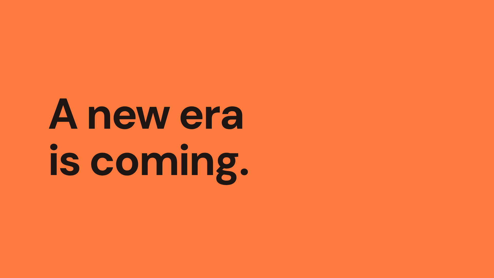
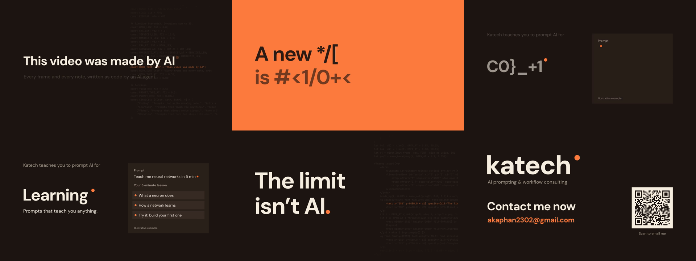

# Katech — intro video (30 s)

> **The limit isn't AI. It's your imagination.**

**▶ Watch:** [`katech-intro-30s.mp4`](katech-intro-30s.mp4) (1920×1080, 30 fps, 30 s, stereo)

Katech is a consultancy that teaches people to prompt AI for **coding, learning, making videos and optimising their workflow**.

**Contact:** [akaphan2302@gmail.com](mailto:akaphan2302@gmail.com)

---

## About the video

This video was made by AI. An AI agent wrote every scene, the animation and the music as code, then rendered it. The photographs are real public-domain images, not AI-generated.

**Concept, "The Dot":** the orange dot from the Katech logo is the only character. It blinks as a typing cursor, swells into the title, jumps between the four services, becomes the full stop of the main line, opens a window onto human imagination, and lands back on the logo.

| Time | Scene | On screen |
|---|---|---|
| 0–3 s | Hook | "This video was made by AI", typed by the dot, over the video's own source code |
| 3–7 s | New era | "A new era is coming." decodes from code symbols on an orange field |
| 7–17 s | Services | Four 2.5 s examples, each a prompt and its result: Coding, Learning, Video, Workflow |
| 17–24 s | Manifesto | "The limit isn't AI." The full stop opens onto "It's your imagination." over archival images |
| 24–30 s | Call to action | Katech logo, "Contact me now", the email, and a QR code that opens an email |

The prompt-and-result examples in the services scene are illustrative, not client work.

## Technical details

- **Format:** 1920×1080, 30 fps, H.264 + AAC stereo, 30.0 s (900 frames)
- **Loudness:** −14.9 LUFS integrated, true peak −1.0 dBTP (social-media standard)
- **Rendering:** [fframes](https://github.com/dmtrKovalenko/fframes) (Rust, SVG scenes, Skia GPU)
- **Music and sound effects:** composed in code and synthesised with ffmpeg at 120 BPM, so every cut lands on a beat. No third-party audio.
- **Typefaces:** DM Sans, JetBrains Mono (SIL Open Font License)
- **Brand colours:** `#1e1612` background · `#f6ede1` cream · `#ff7a3d` orange

## Files

| File | What it is |
|---|---|
| `katech-intro-30s.mp4` | The video |
| `captions.srt` | On-screen text with timings, for platforms that support captions |
| `assets/thumbnail.png` | Cover / thumbnail |
| `assets/end-card.png` | Final frame with the contact details |
| `credits.txt` | Image, font and audio credits |

## Credits

Images (public domain, via Wikimedia Commons): *Drawing of a flying machine* by Leonardo da Vinci; *Earthrise* (Apollo 8) by NASA / Bill Anders; *Westerlund 2* (Hubble 25th anniversary) by NASA, ESA and the Hubble Heritage Team. Full list in [`credits.txt`](credits.txt).

© Katech. All rights reserved.
